# Real-Time Motor Health Monitoring and Predictive Fault Detection

An embedded Edge AI system designed for real-time monitoring, multi-sensor data fusion, and predictive fault diagnostics of electric motors using the ESP32 microcontroller.

For a comprehensive study of the system's design, mathematical modeling, and experimental results, please refer to the full [Project Report](Docs/Project_Report.pdf).

---

## 1. Overview
This project performs feature extraction and motor-state classification locally on the ESP32. Local monitoring continues without cloud connectivity; Wi-Fi and Blynk run separately from sensor acquisition.

An on-device Decision Tree combines vibration, current, RPM and temperature features to classify motor conditions. Independent thermal/current thresholds supplement the model. The system also computes a **Health-based Maintenance Score**, a 0–100-point condition indicator used for maintenance advice.

---

## 2. Key Features
*   **Multi-Sensor Monitoring:** Windowed acquisition of vibration and current, asynchronous temperature conversion, and interrupt-based rotational speed (RPM).
*   **On-Device Feature Extraction:** Statistical signal processing (RMS, mean, standard deviation) computed directly on the ESP32.
*   **Edge Machine Learning:** Local inference via an optimized Decision Tree classifier (zero cloud latency or dependency).
*   **Health Diagnostics:** A filtered Motor Health Index and a Health-based Maintenance Score for condition monitoring and maintenance advice.
*   **Multi-Tier Output System:**
    *   *Local UI:* SSD1306 OLED display for immediate parameter reading.
    *   *System Status Display:* Dedicated 16x2 LCD module controlled via an Arduino Uno.
    *   *Visual/Audible Alerts:* Status LEDs (Normal, Warning, Fault) and an active buzzer.
*   **IoT Integration:** Real-time remote telemetry and status dashboard using Blynk.

---

## 3. System Architecture

The architecture consists of three core operational layers:

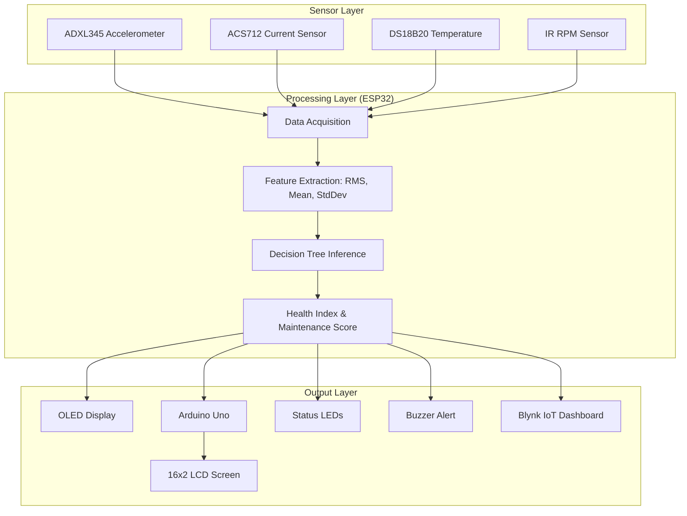

### 3.1 Data Flow and Multitasking Concurrency

The system is architected around deterministic real-time data acquisition and non-blocking telemetry using the ESP32's dual-core FreeRTOS environment:

1.  **Core 1 (Deterministic Sensor DAQ and Edge Inference Task):**
    *   **Acquisition:** Executes windowed sampling for 3-axis vibration (ADXL345 at 100 Hz, 150 samples over ~1.5 seconds) and analog current (ACS712 with zero-current midpoint reference), non-blocking asynchronous 12-bit temperature conversion (DS18B20, 750 ms cycle), and optical interrupt-driven rotational speed (IR sensor with 10 ms debounce).
    *   **Feature Extraction:** Computes numerical RMS, mean, and standard deviation using stable single-pass Welford variance formulas to prevent floating-point cancellation.
    *   **Edge Machine Learning:** Evaluates an on-device Decision Tree classifier directly in C++.
    *   **Fault Confirmation Filter:** Requires three consecutive identical fault predictions before declaring a confirmed anomaly, preventing spurious transient trips.
    *   **Safety Overrides:** Independent thermal (temperature > 60.0 deg C) and overcurrent thresholds bypass classifier output, ensuring immediate trip protection even if the motor is stationary or the model predicts normal operation.
    *   **Local UI & Actuation:** Drives the SSD1306 OLED display, transmits formatted UART packets to the secondary Arduino Uno LCD module at 9600 baud, and actuates status LEDs and the alert buzzer.

2.  **Core 0 (Cloud Telemetry and IoT Task):**
    *   **Decoupled Queue Snapshot:** Receives state updates from Core 1 through a thread-safe, single-element FreeRTOS queue (`xQueueOverwrite`).
    *   **Network Fault Isolation:** Handles Wi-Fi connectivity and Blynk cloud synchronization asynchronously. Telemetry retries and network timeouts (DNS/TCP/TLS) are strictly confined to Core 0, guaranteeing that cloud disconnects, latency spikes, or offline states never block or jitter local motor health monitoring on Core 1.
    *   **Reliable State Recovery:** Retains pending critical alert events in RAM across network reconnections with automatic event coalescing.

3.  **Secondary Subsystem (Arduino Uno 16x2 LCD Controller):**
    *   Receives serial packets over UART (Pin 2 RX from ESP32 GPIO25 TX) with a shared ground reference.
    *   Parses bounded newline-delimited frames, displays animated status screens, and asserts `ESP32 LINK LOST` if no valid heartbeat is received within 7 seconds.

### 3.2 System Flowchart
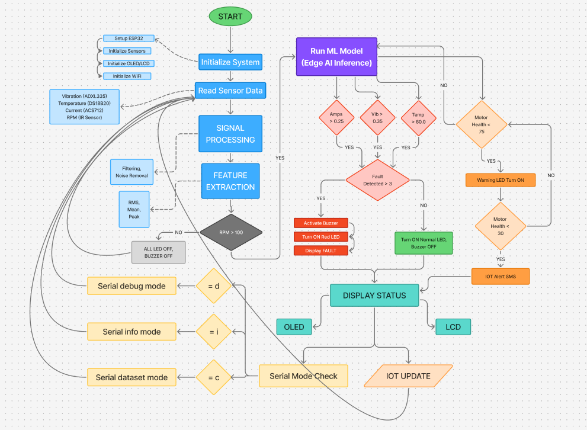

---

## 4. Hardware Configuration & Wiring

### 4.1 Bill of Materials (BOM)
Detailed component specifications are available in the project's [BOM Spreadsheet](BOM_v1.xlsx). A quick summary of key parts:

| S.No | Component | Quantity | Primary Function |
| :--- | :--- | :--- | :--- |
| 1 | ESP32 Microcontroller | 1 | System hub, feature extraction, and ML inference |
| 2 | ADXL345 Accelerometer | 1 | 3-axis acceleration/vibration monitoring |
| 3 | ACS712 Current Sensor (20A) | 1 | Current draw measurement |
| 4 | DS18B20 Temperature Sensor | 1 | Thermal analysis |
| 5 | IR Speed Sensor | 1 | Rotational speed (RPM) calculation |
| 6 | SSD1306 OLED (128x64) | 1 | Live parameter display |
| 7 | Arduino Uno | 1 | Handles secondary UART-to-LCD display pipeline |
| 8 | LCD Module (16x2 I2C) | 1 | Continuous status text output |
| 9 | Buzzer & Status LEDs | 4 | Real-time audio-visual alerts |

### 4.2 Pin Mappings

#### ESP32 Microcontroller
| Connected Device | ESP32 Pin | Interface Type | Purpose |
| :--- | :--- | :--- | :--- |
| **IR Sensor** | GPIO27 | Digital Input | RPM measurement |
| **ACS712 Sensor** | GPIO34 | Analog Input | Current monitoring |
| **DS18B20 Sensor** | GPIO4 | One-Wire | Temperature monitoring |
| **SSD1306 OLED** | GPIO21 (SDA) / GPIO22 (SCL) | I2C | Local data visualization |
| **ADXL345 Sensor** | GPIO21 (SDA) / GPIO22 (SCL) | I2C (Shared) | Vibration data acquisition |
| **Buzzer** | GPIO26 | Digital Output | Alarm trigger |
| **Normal LED** | GPIO18 | Digital Output | Indicates healthy operation |
| **Warning LED** | GPIO19 | Digital Output | Indicates moderate anomalies |
| **Fault LED** | GPIO33 | Digital Output | Indicates critical failure state |
| **Arduino Uno** | GPIO25 (TX) | UART Serial | Status transmission |

#### Arduino Uno (LCD Subsystem)
| Connected Device | Arduino Pin | Interface Type | Purpose |
| :--- | :--- | :--- | :--- |
| **ESP32 TX** | Pin 2 (RX) | SoftwareSerial | Receives status packets |
| **LCD SDA / SCL** | Pin A4 / Pin A5 | I2C | Screen control output |

> [!IMPORTANT]
> A common Ground (GND) wire must connect the ESP32 and the Arduino Uno. Without a shared ground reference, serial UART communications will fail or generate corrupted data packets.

---

## 5. Repository Directory Structure
```
Real-Time-Motor-Health-Monitoring-and-Predictive-Fault-Detection/
│
├── Docs/                              # Technical diagrams and project files
│   ├── block_diagram.png              # System structural layout
│   ├── flow_chart.png                 # Processing logic flowchart
│   └── Project_Report.pdf             # Comprehensive technical paper
│
├── Firmware/                          # Main modular ESP32 firmware (v2)
│   ├── Firmware.ino                   # Main execution loop and setup
│   ├── config.h                       # Pin mappings, thresholds & offline defaults
│   ├── secrets.example.h              # Template for ignored local secrets.h
│   ├── sensors.h                      # Sensor drivers & sampling logic
│   ├── features.h                     # RMS & Mean computation utilities
│   ├── ai_engine.h                    # Model execution framework
│   ├── health_model.h                 # Health index & maintenance score
│   ├── display_oled.h                 # SSD1306 screen controller
│   ├── iot_blynk.h                    # Cloud Wi-Fi & Blynk sync
│   ├── lcd_serial.h                   # UART communication to Arduino
│   ├── logger.h                       # Debug logging via Serial
│   ├── alerts.h                       # Alert logic for buzzer & LEDs
│   ├── calibration.h                  # Sensor calibration utilities
│   ├── motor_model.h                  # Machine learning classifier header
│   └── syk_oled_bitmap.h              # Bitmap assets for OLED
│
├── Firmware_old/                       # Synchronized monolithic firmware
│   ├── Firmware_old.ino                # Monolithic ESP32 code structure
│   └── motor_model.h                  # Machine learning classifier header
│
├── LCD_Display/                       # Subsystem driving the 16x2 LCD
│   ├── LCD_Display.ino                # Arduino-compatible primary sketch
│   └── Arduino_LCD_Animation.ino      # Bounded UART parser & LCD rendering
│
├── Machine_Learning/                  # Python workspace for model training
│   ├── dataset.txt                    # Raw sensor telemetry logs
│   ├── train_motor_model.py           # Random Forest training script
│   ├── training.py                    # Shared validation & grouped evaluation
│   ├── generate_synthetic_data.py     # Explicitly labeled simulation scenarios
│   ├── synthetic_dataset.csv         # Artificial feature readings; not real logs
│   ├── requirements.txt               # Python dependencies; matches saved models
│   ├── train_tinyml_model.py          # Decision Tree training script
│   ├── convert_to_c.py                # TinyML C header exporter
│   ├── motor_fault_model.pkl          # Serialized Random Forest model
│   ├── tinyml_model.pkl               # Serialized Decision Tree model
│   └── motor_model.h                  # Exported C class representing DT
│
├── Images/                            # Physical wiring & setup photo gallery
│   ├── acs712_current_sensor_setup.jpg
│   ├── adxl345_vibration_sensor_setup.jpg
│   ├── ds18b20_temp_sensor_setup.jpg
│   ├── full_system_setup.jpg
│   ├── hardware_breadboard_setup.jpg
│   └── motor_fan_system_setup.jpg
│
├── hardware/                          # Microcontroller circuit diagrams
│   ├── Arduino_Circuit/
│   │   └── arduino_lcd_circuit_diagram.jpeg
│   └── ESP32_Circuit/
│       └── esp32_breadboard_circuit_diagram.png
│
├── BOM_v1.xlsx                        # Bill of Materials Spreadsheet
├── circuit_diagram.png                # Overall electrical connection schematic
├── LICENSE                            # MIT License
└── README.md                          # Repository documentation
```

---

## 6. Machine Learning Pipeline

The ESP32 uses the saved Decision Tree exported to `motor_model.h`. The Random Forest is an offline comparison model and is not loaded by the firmware.

```text
dataset.txt (independently labeled sensor measurements)
    → schema validation and duplicate removal
    → grouped evaluation using 30-second timestamp blocks
    → deterministic fit on all distinct labeled rows
    → tinyml_model.pkl → convert_to_c.py → three motor_model.h copies
```

### 6.1 Input Features

| Index | Dataset column | Measurement |
| :--- | :--- | :--- |
| 0 | `vib_rms` | Acceleration magnitude RMS, m/s² |
| 1 | `vib_mean` | Acceleration magnitude mean, m/s² |
| 2 | `vib_std` | Acceleration magnitude standard deviation, m/s² |
| 3 | `current_rms` | Current RMS, A |
| 4 | `current_mean` | Absolute current mean, A |
| 5 | `current_std` | Absolute current standard deviation, A |
| 6 | `rpm` | Filtered rotational speed, RPM |
| 7 | `temp_C` | Temperature, °C |

Vibration magnitude includes gravity, matching the existing dataset and saved models. The firmware does not subtract a resting baseline from the mean alone. Both sensor statistics use a stable online variance calculation to avoid cancellation in nearly constant signals. Changing units, sensor scaling, sample timing or feature definitions requires new validation and potentially retraining.

### 6.2 Class IDs and Runtime States

The exported class IDs are `0=NORMAL`, `1=OVERCURRENT`, `2=OVERHEAT`, `3=STOPPED`, `4=UNBALANCE`. Warning is a separate health-threshold indication, not a learned class. `SENSOR_ERROR` and `LOW_HEALTH` are firmware diagnostic states, not training labels. Valid health below the critical threshold activates the red LED and buzzer even when the classifier says normal/stopped.

Three consecutive predictions of the **same fault** confirm it. Changing the candidate fault resets confirmation. Thermal/current thresholds are also checked even when RPM is low or the model predicts normal/stopped. A confirmed electrical or thermal fault therefore keeps the red LED and buzzer active on a stopped motor. Invalid sensor windows immediately raise `SENSOR_ERROR` and are excluded from ML inference and dataset logging.

### 6.3 Reusing Models and Retraining Without Hardware

No hardware is required to use the existing models, re-export the saved tree, or retrain from `Machine_Learning/dataset.txt`.

- **Use the existing firmware model:** the checked-in headers already contain the classifier; Python is unnecessary for normal device operation.
- **Re-export the saved tree:** run `convert_to_c.py`. This changes the representation, not the learned model.
- **Generate new models from existing data:** run the training scripts below. They fit new estimators from the recorded dataset; the saved Decision Tree/Random Forest do not support incremental learning with `partial_fit`.

Saved weights alone cannot supply new ground truth. Retraining on the same observations may change the tree and evaluation results, but does not establish better performance on new motors.

The supplied dataset has 919 rows and 833 distinct labeled sensor vectors after duplicate removal. The raw recordings are preserved. The scripts validate the exact schema and class set, reject invalid/unlabeled records, remove repeated sensor vectors, and report accuracy, balanced accuracy, macro F1, class precision/recall and a confusion matrix. Identical timestamps stay in the same 30-second block.

Training now gives every class equal total weight. Within each class, a row's initial weight is inversely proportional to the square root of the number of observations in its 30-second class/time block; weights are then normalized by class. This reduces majority-class and densely sampled-block dominance without inventing or duplicating measurements. Weights are calculated from each training fold only. Both estimators use a fixed random seed and a minimum leaf size to limit reliance on isolated samples. After evaluation they fit on all retained rows. Each saved model contains `training_metadata_` with the dataset hash, class/block counts, weighting policy and evaluation results.

There are no reliable independent motor/run identifiers in this file. Time blocks only approximate independent recordings, and overheating examples are concentrated in one block. A fold may have no training examples of a held-out class; the scripts explicitly report that limitation. These results must not be presented as independent real-world validation.

### 6.3 Model Evaluation & Performance Benchmark Results

The supplied dataset has 919 raw recordings and 833 distinct labeled sensor vectors after deduplication (`NORMAL`: 532, `OVERCURRENT`: 110, `STOPPED`: 77, `UNBALANCE`: 68, `OVERHEAT`: 46). Two rigorous validation protocols evaluate generalizability:

1.  **Grouped Time-Block Stress Test (StratifiedGroupKFold, 5 Folds):** Grouped into 30-second timestamp blocks to test robustness across unseen operating sessions and minimize temporal data leakage.
2.  **Stratified Distinct-Vector Diagnostic (StratifiedKFold, 5 Folds):** Evaluates overall state separability ensuring all 5 classes are represented in every training fold.

Training employs balanced weighting: each class receives equal aggregate mass, with individual sample weights inversely proportional to the square root of the class/time-block density. This prevents dominant classes or dense recording bursts from skewing decision boundaries.

#### Executive Summary Benchmark

| Model | Evaluation Protocol | Accuracy | Balanced Accuracy | Macro F1 | Normal False Alarm Rate |
| :--- | :--- | ---: | ---: | ---: | ---: |
| **Decision Tree (On-Device TinyML)** | Grouped Time-Block Stress Test | 83.67% | 74.43% | 0.6878 | 14.85% |
| **Decision Tree (On-Device TinyML)** | Stratified Distinct-Vector Diagnostic | 89.80% | 94.69% | 0.9069 | 13.91% |
| **Random Forest (Offline Baseline)** | Grouped Time-Block Stress Test | 87.64% | 74.14% | 0.7165 | 10.90% |
| **Random Forest (Offline Baseline)** | Stratified Distinct-Vector Diagnostic | 93.52% | 94.66% | 0.9314 | 9.21% |

#### Detailed Per-Class Breakdown (Stratified Diagnostic)

| Class | Support | Decision Tree (TinyML) Precision | Decision Tree (TinyML) Recall | Decision Tree (TinyML) F1 | Random Forest Precision | Random Forest Recall | Random Forest F1 |
| :--- | ---: | ---: | ---: | ---: | ---: | ---: | ---: |
| **NORMAL** | 532 | 97.65% | 86.09% | 0.9151 | 97.77% | 90.79% | 0.9415 |
| **OVERCURRENT** | 110 | 64.60% | 94.55% | 0.7675 | 80.95% | 92.73% | 0.8644 |
| **OVERHEAT** | 46 | 100.00% | 100.00% | 1.0000 | 93.88% | 100.00% | 0.9684 |
| **STOPPED** | 77 | 98.70% | 98.70% | 0.9870 | 98.70% | 98.70% | 0.9870 |
| **UNBALANCE** | 68 | 80.00% | 94.12% | 0.8649 | 75.86% | 97.06% | 0.8516 |
| **Overall Macro Avg** | 833 | 88.19% | 94.69% | 0.9069 | 89.43% | 95.86% | 0.9226 |

#### Out-of-Fold Confusion Matrices (Stratified Diagnostic)

##### Decision Tree (TinyML Deployed Model)
| Actual \ Predicted | NORMAL | OVERCURRENT | OVERHEAT | STOPPED | UNBALANCE |
| :--- | ---: | ---: | ---: | ---: | ---: |
| **NORMAL** | 458 | 57 | 0 | 1 | 16 |
| **OVERCURRENT** | 6 | 104 | 0 | 0 | 0 |
| **OVERHEAT** | 0 | 0 | 46 | 0 | 0 |
| **STOPPED** | 1 | 0 | 0 | 76 | 0 |
| **UNBALANCE** | 4 | 0 | 0 | 0 | 64 |

##### Random Forest (Offline Baseline Model)
| Actual \ Predicted | NORMAL | OVERCURRENT | OVERHEAT | STOPPED | UNBALANCE |
| :--- | ---: | ---: | ---: | ---: | ---: |
| **NORMAL** | 483 | 24 | 3 | 1 | 21 |
| **OVERCURRENT** | 8 | 102 | 0 | 0 | 0 |
| **OVERHEAT** | 0 | 0 | 46 | 0 | 0 |
| **STOPPED** | 1 | 0 | 0 | 76 | 0 |
| **UNBALANCE** | 2 | 0 | 0 | 0 | 66 |

#### Analysis of Operational Trade-Offs
*   **Sensitivity vs. False Alarm Rate:** Inverse square-root density weighting significantly elevates minority-fault sensitivity: on the Decision Tree, overcurrent recall increased from 83.64% to 94.55% and unbalance recall from 86.76% to 94.12%. This intentional safety-first prioritization trade-off increases normal false alarms from 4.51% to 13.91%, which is buffered at runtime by the 3-cycle consecutive confirmation filter.
*   **Thermal Run Limitation & Safety Thresholds:** Because recorded overheating samples occurred within a single session block, holding out that block yields 0% learned recall during grouped cross-validation. To eliminate this operational risk, firmware safety thresholds (temperature > 60.0 deg C and current > 0.25 A) run independently in hardware logic to guarantee fault trips regardless of classifier predictions.

---

### 6.4 Artificial Readings and Optional Synthetic Training

`Machine_Learning/synthetic_dataset.csv` contains **640 artificial feature vectors**, 128 for each of the five classes. Every row includes `source=SYNTHETIC_RULE_SIMULATION` and a `SIM_...` scenario identifier. These identifiers group simulations; they are **not independent motor recordings**. The original `dataset.txt` is unchanged, and its strict loader rejects the synthetic file's extra provenance columns.

The generator assumes single-fault operating states: normal operation, elevated current, temperatures from 60–90 °C, a stopped motor, or increased vibration. Running baseline magnitudes use real NORMAL training readings. Magnitude/current features satisfy `RMS² = mean² + standard deviation²`. These are assumed feature vectors, not simulated raw waveforms or a calibrated motor-physics model. The ranges use this project's current 60 °C / 0.25 A thresholds; review the recipe if changing those settings.

Regenerate the clearly labeled file with:

```powershell
.venv\Scripts\python Machine_Learning/generate_synthetic_data.py
```

Optional `--synthetic` training adds **only 128 artificial overheating rows**. The other generated states are software exercises, since invented mechanical/electrical combinations can conflict with measured normal transients. Synthetic examples are generated after splitting, using only that fold's real training partition. Their combined training weight is capped at 10% of the real training weight. Both evaluation protocols continue to use **real held-out readings only**; synthetic scenarios never count as independent validation. Saved experimental model metadata records the recipe, seed, training classes, weight cap and lack of independent recordings.

The following experimental commands replace the saved `.pkl` files. They are optional and are not the recipe used by the currently deployed classifier:

```powershell
.venv\Scripts\python Machine_Learning/train_tinyml_model.py --synthetic
.venv\Scripts\python Machine_Learning/train_motor_model.py --synthetic
```

Export with `convert_to_c.py` only after reviewing an experimental model's results; export replaces all three firmware headers.

The thermal-only trial left the Decision Tree's stratified normal false-fault rate at **13.72%**, but worsened the time-block rate from **14.85% to 18.05%**. The real-data-only saved models and firmware headers were therefore retained. The synthetic scenarios passed the 512 normal/stopped/electrical/thermal software checks. Of the 128 hypothetical imbalance cases, 84 cool-motor cases did not match the model's predicted class; this is an exploratory simulation coverage gap, not a measured physical miss rate. Artificial readings provide useful exercises and explicit rule-based training priors, but do not resolve the need for independent real overheating recordings or establish field accuracy.

---

## 7. Mathematical Modeling for Health & Maintenance Score

### 7.1 Motor Health Index

With configured vibration/current/temperature thresholds \(V_t,I_t,T_t\):

$$S_v=50\max(0,\sigma_v/V_t-0.6),\quad S_i=30\max(0,I_{RMS}/I_t-0.6),\quad S_t=20\max(0,T/T_t-0.7)$$

$$H_n=\operatorname{clamp}\left(0.3(100-S_v-S_i-S_t)+0.7H_{n-1},0,100\right)$$

The stored filter state is clamped too. Missing, clipped, nonfinite or out-of-range sensor data makes health unavailable (`-1`), rather than reporting a healthy value. The OLED shows a sensor-error screen and the alarm remains active.

### 7.2 Health-based Maintenance Score

$$\text{Maintenance score}=\operatorname{clamp}\left(1.25(H-20),0,100\right)$$

The firmware computes this score with `computeMaintenanceScore()` and truncates it to an integer. Its unit is **points**, not hours or percentage of remaining lifetime. Higher values indicate a healthier condition under the current scoring rules. `-1` means the score is unavailable because of invalid sensor data. The existing formula and maintenance-advice thresholds are unchanged.

Validated time-to-failure prediction remains future research: it requires independent run-to-failure recordings and measured lifetime targets that are absent from the current dataset.

| Score | Advice |
| :--- | :--- |
| Above 80 | Healthy |
| Above 30 through 80 | Service Soon |
| 0 through 30 | Immediate Maintenance Required |
| -1 (unavailable) | Sensor check required |

### 7.3 Calibration and Sampling

- **Current:** startup averages 500 readings to obtain the zero-current offset. Keep the motor **off** during calibration. ADC rail readings fail calibration and raise a sensor alarm; restart after correcting the input. A running motor can still invalidate zero-current calibration, so the software cannot replace that startup requirement.
- **Vibration:** the ADXL345 is configured for 100 Hz; 150 magnitude readings are spaced by 10 ms. This window takes about 1.5 seconds plus driver overhead. `calibrateVibrationBaseline()` remains a diagnostic helper; its result is not subtracted from ML features.
- **Temperature:** DS18B20 conversions run asynchronously at 12-bit resolution. Disconnect sentinels and readings outside −55 to 125 °C are rejected. `calibrateTemperatureOffset()` applies an optional checked correction.
- **RPM:** the default assumes one pulse per revolution. Adjust `RPM_PULSES_PER_REVOLUTION` for another encoder. The 10 ms debounce limits accepted pulse frequency. Counting starts after startup screens; measurements use actual elapsed time and overrange RPM is invalidated.
- **Cadence:** the minimum sampling interval is 1 second, but the 150-sample vibration window makes normal updates approximately 1.5 seconds or longer. Confirmation takes three measurement windows, not a guaranteed three seconds.
- **Electrical calibration:** current conversion retains the original ideal 3.3 V/12-bit scaling and 0.1 V/A sensitivity. Confirm the sensor variant, safe ESP32 input voltage and any divider gain physically before relying on absolute current readings.

---

## 8. Setup & Deployment Guide

### Phase 1: Hardware Assembly

Use the wiring tables in Section 4 and the [circuit diagram](circuit_diagram.png). Connect ESP32 GPIO25 (TX) to Uno pin 2 (RX) and share GND. Keep the motor off while the ESP32 boots and calibrates its current sensor. Verify sensor outputs and I2C pull-ups are suitable for the ESP32 input voltage.

### Phase 2: Arduino Environment

1. Install the [Arduino IDE](https://www.arduino.cc/en/software).
2. Add the ESP32 Boards Manager URL:

   ```text
   https://espressif.github.io/arduino-esp32/package_esp32_index.json
   ```

3. Install ESP32 board support by Espressif Systems, selecting **2.0.17**, and Arduino AVR board support **1.8.8** for the Uno. The ESP32 builds were verified for **ESP32 Dev Module** (`esp32:esp32:esp32`), matching this project's classic ESP32 pinout.
4. Install the following tested library versions. Other board families or core versions require their own compilation checks.

   | Library | Reviewed version |
   | :--- | :--- |
   | Adafruit ADXL345 | 1.3.4 |
   | Adafruit Unified Sensor | 1.1.15 |
   | Adafruit BusIO | 1.17.4 |
   | Adafruit GFX Library | 1.13.0 |
   | Adafruit SSD1306 | 2.5.17 |
   | DallasTemperature | 4.0.6 |
   | OneWire | 2.3.8 |
   | Blynk | 1.4.0 |
   | hd44780 | 1.3.2 |

### Phase 3: Optional Blynk Configuration

Create an ESP32/Wi-Fi template and device in the [Blynk console](https://blynk.cloud/). Configure these datastreams and the `motor_fault` event with the notifications you want:

| Virtual pin | Value |
| :--- | :--- |
| V0 | Temperature, °C |
| V1 | Vibration RMS, m/s² |
| V2 | Current RMS, A |
| V3 | Health, % |
| V4 | Status string |
| V5 | Filtered RPM |
| V6–V9 | Normal LED, warning LED, fault LED, buzzer (0/1) |
| V10 | Health-based Maintenance Score, points (0–100; -1 unavailable) |
| V11 | Maintenance advice |

Allow `-1` for unavailable numeric telemetry, health and maintenance score; use V4 to identify sensor errors. Health and maintenance score both have a valid range of 0–100. For an existing dashboard, rename the **V10 datastream and its widget** to **Health-based Maintenance Score**, replace the `%` unit with **points**, and allow the unavailable value `-1`. The firmware continues sending the score on V10, so no pin reassignment is needed. Suggested display ranges must include the recorded vibration RMS (up to about 12.11 m/s²); a 0–10 gauge clips it.

Blynk and Wi-Fi run in a separate FreeRTOS task. A one-element queue passes the latest telemetry without sharing mutable strings. Telemetry is attempted every 2 seconds while connected. Wi-Fi/cloud retries occur at 10-second intervals and cloud connection attempts have an explicit 3-second protocol timeout; underlying DNS/TCP calls may take longer but run outside sensor acquisition. A critical event remains pending in RAM across disconnection, including if health recovers before reconnecting; multiple offline events coalesce to the latest pending event. A connected send attempt is not a server delivery acknowledgment, and a reset loses pending RAM state.

### Phase 4: Local Credentials

Copy `Firmware/secrets.example.h` to **`secrets.h` beside the sketch you use**, and enter your own Wi-Fi and Blynk values. For the monolithic version, put the copy at `Firmware_old/secrets.h`. Both locations are ignored by Git.

```cpp
#define WIFI_SSID "YOUR_WIFI_SSID"
#define WIFI_PASS "YOUR_WIFI_PASSWORD"
#define BLYNK_TEMPLATE_ID "YOUR_TEMPLATE_ID"
#define BLYNK_TEMPLATE_NAME "Motor Health Monitoring"
#define BLYNK_AUTH_TOKEN "YOUR_BLYNK_AUTH_TOKEN"
```

Credentials are optional: with no `secrets.h`, local monitoring works offline. Previously committed real credentials should be rotated; excluding them from new commits does not remove them from Git history.

`Firmware/Firmware.ino` is the maintained modular entry point. `Firmware_old/Firmware_old.ino` is a synchronized standalone monolithic copy with the same fixes. Make future changes in the modular version first, then synchronize the monolithic copy if using it.

### Phase 5: Compile and Upload

1. **Uno:** open `LCD_Display/LCD_Display.ino` and select Arduino Uno. `Arduino_LCD_Animation.ino` in the same directory contains the implementation and is compiled automatically. The primary sketch now matches the folder name.
2. **ESP32:** open `Firmware/Firmware.ino`, or the monolithic sketch, and select the actual ESP32 board and port.
3. Compile before uploading. If required by your board, hold BOOT during the initial upload connection.

With Arduino CLI and the pinned board/library versions installed, the corresponding build commands from the repository root are:

```powershell
arduino-cli compile --fqbn esp32:esp32:esp32 Firmware
arduino-cli compile --fqbn esp32:esp32:esp32 Firmware_old
arduino-cli compile --fqbn arduino:avr:uno LCD_Display
```

The LCD accepts bounded newline-delimited UART packets at 9600 baud, abbreviates overcurrent to `FLT:OVERCURRENT`, and shows `ESP32 LINK LOST` after 7 seconds without a valid frame. ESP32 status heartbeats refresh an unchanged display about every 2–3 seconds, including after a Uno-only reset. Network retries no longer overwrite motor alarms on the LCD.

### Phase 6: Python Models, With or Without Hardware

From the repository root, install dependencies in a virtual environment:

```powershell
python -m venv .venv
.venv\Scripts\python -m pip install -r Machine_Learning/requirements.txt
```

The requirements pin scikit-learn 1.8.0, matching the checked-in pickle files. Use only trusted pickle files. The exporter rejects a version mismatch, an unsupported estimator, a different feature order or incompatible class IDs before writing any headers. Training verifies the serialized model before saving. Where a Windows file grants write access but denies rename/replace, saving uses a verified in-place fallback without changing ACLs; this fallback is not crash-atomic.

**Re-export the existing saved Decision Tree without retraining:**

```powershell
.venv\Scripts\python Machine_Learning/convert_to_c.py
```

**Optionally generate new models from the supplied dataset:**

```powershell
.venv\Scripts\python Machine_Learning/train_tinyml_model.py
.venv\Scripts\python Machine_Learning/train_motor_model.py
.venv\Scripts\python Machine_Learning/convert_to_c.py
```

Training replaces the corresponding `.pkl` files, and export automatically updates `Machine_Learning/motor_model.h`, `Firmware/motor_model.h`, and `Firmware_old/motor_model.h`. No manual header copying is needed. Rebuild and upload the firmware after exporting a replacement tree. The saved models have been retrained with balanced class/time-block weighting, and all three classifier headers have been regenerated from the updated Decision Tree.

For later data collection, send `c` at 115200 baud. The logger prints exactly:

```csv
time_ms,vib_rms,vib_mean,vib_std,current_rms,current_mean,current_std,rpm,temp_C,status
```

Select an independently known label with `0` (NORMAL), `1` (OVERCURRENT), `2` (OVERHEAT), `3` (STOPPED), or `4` (UNBALANCE); `u` clears it. Each entry to CSV mode starts at `UNLABELED`. Rows are **not** labeled using the model prediction. Exclude or independently label `UNLABELED` rows before training. Invalid sensor windows are not logged. Capture only the CSV header and records; debug output and boot messages are not CSV. External data must use the same feature units, definitions, class names and ten-column schema.

---

## 9. Verification Status and Hardware Checks

Software verification of the corrected code includes:

- 36 simulated behavior checks for each ESP32 firmware variant, covering sensor errors, stopped-motor faults, matching-fault confirmation, health and maintenance score bounds, stable variance, invalid class IDs, critical-health alarms, independent CSV labels, LCD heartbeats, and queued cloud events.
- Nine simulated LCD checks covering malformed/oversized packets, partial-frame timeout, display width, unchanged status, and link-loss recovery.
- Isolated training/export checks, deterministic retraining checks, and verification of the actual saved artifacts. The regenerated C++ model matches Python on **10,952** recorded, random and split-boundary inputs; all three exported headers are identical.

### 9.1 Hardware Resource Utilization & Compilation Benchmarks

| Hardware Target | Firmware Variant | Flash Memory (ROM) | Static Memory (RAM) | Utilization Profile | Toolchain & Core Version |
| :--- | :--- | ---: | ---: | :--- | :--- |
| **ESP32 Dev Module** | Modular (`Firmware/Firmware.ino`) | 797,385 bytes | 46,320 bytes | 60.8% Program / 14.1% RAM | Espressif ESP32 Core 2.0.17 |
| **ESP32 Dev Module** | Monolithic (`Firmware_old/Firmware_old.ino`) | 797,385 bytes | 46,320 bytes | 60.8% Program / 14.1% RAM | Espressif ESP32 Core 2.0.17 |
| **Arduino Uno (ATmega328P)** | LCD Display Subsystem (`LCD_Display/LCD_Display.ino`) | 10,612 bytes | 905 bytes | 32.9% Flash / 44.2% SRAM | Arduino AVR Core 1.8.8 |

The RPM interrupt handler is explicitly defined once in the sketch entrypoint to avoid Xtensa toolchain inline-IRAM literal placement relocation errors. In both ESP32 builds, static memory leaves abundant headroom for the FreeRTOS dual-core task stacks, Wi-Fi buffers, and Blynk queues.

Temporary audit tests, reports and build output are excluded from the GitHub project layout. No board was flashed during software verification. On Windows, a deeply nested local toolchain may exceed the compiler's path-length limit; use a short installation/build path or a temporary `subst` drive mapping. The completed board builds used a temporary short mapping without moving the repository. OneWire/AVR dependencies emit upstream warnings, but all three sketches link successfully.

When hardware is available again, check:

1. Sensor calibration, safe voltage levels, actual sampling cadence and readings against references.
2. Sensor disconnects: OLED/LCD show a sensor error; the red LED and buzzer activate, and health and maintenance score become unavailable.
3. Stopped versus faulted behavior: a healthy stopped motor is quiet; confirmed thermal/current faults remain alarms regardless of RPM.
4. Serial commands: `d` for full diagnostics and confirmation count, `i` for compact status, `c` for labeled CSV capture.
5. Uno-only reset and serial-link loss: status refreshes on a heartbeat; removing the link leads to `ESP32 LINK LOST`.
6. Wi-Fi/cloud outages: local sensing continues and a pending critical event is attempted on reconnect. Verify the Blynk event and notification configuration separately.

Wiring, sensor mounting, ADC accuracy, real motor behavior, timing under hardware load and predictive accuracy on independent motors remain physical validation requirements. The firmware reports alarms and advice; it has no motor-disconnect actuator.

---

## 10. Project Media

### 10.1 System Architecture & Diagrams
| System Structural Block Diagram | Execution Pipeline Flowchart |
| :---: | :---: |
| 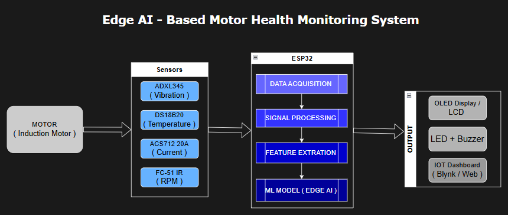 |  |

### 10.2 Electrical Schematics & Circuit Diagrams
* **Overall Circuit Schematic:** [circuit_diagram.png](circuit_diagram.png)
  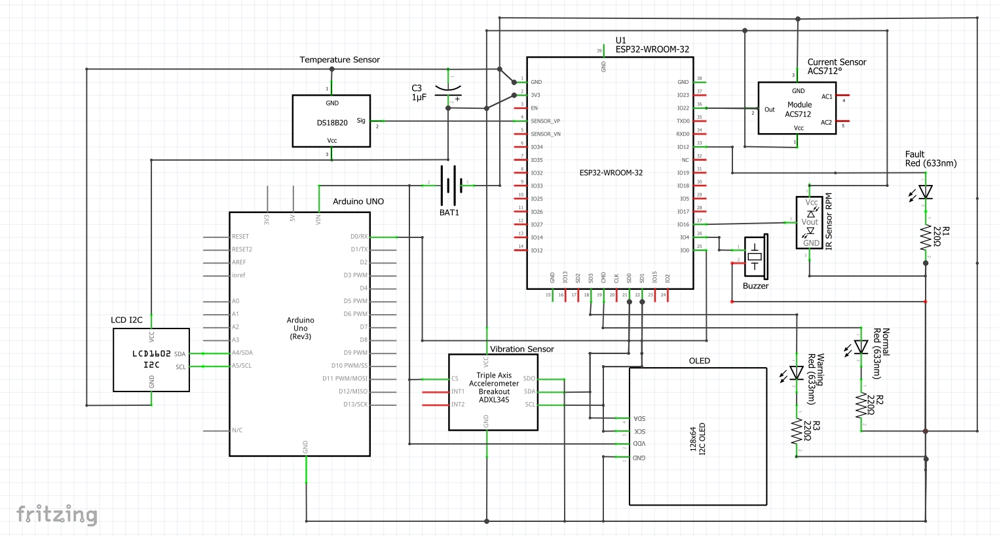

* **ESP32 Breadboard Circuit Diagram:** [hardware/ESP32_Circuit/esp32_breadboard_circuit_diagram.png](hardware/ESP32_Circuit/esp32_breadboard_circuit_diagram.png)
  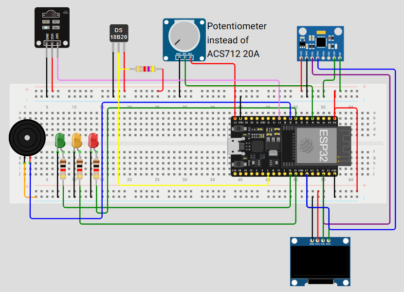

* **Arduino LCD Subsystem Circuit Diagram:** [hardware/Arduino_Circuit/arduino_lcd_circuit_diagram.jpeg](hardware/Arduino_Circuit/arduino_lcd_circuit_diagram.jpeg)
  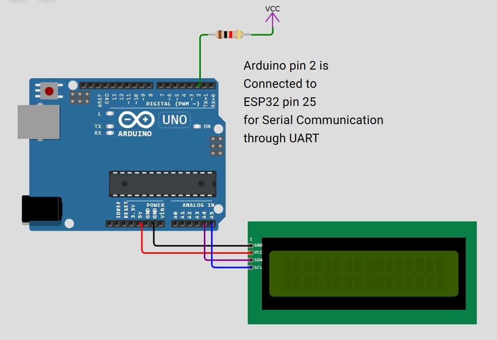

### 10.3 Physical System & Hardware Prototype Setup
| Full Benchtop Monitoring Setup | Motor & Fan Assembly Setup |
| :---: | :---: |
| 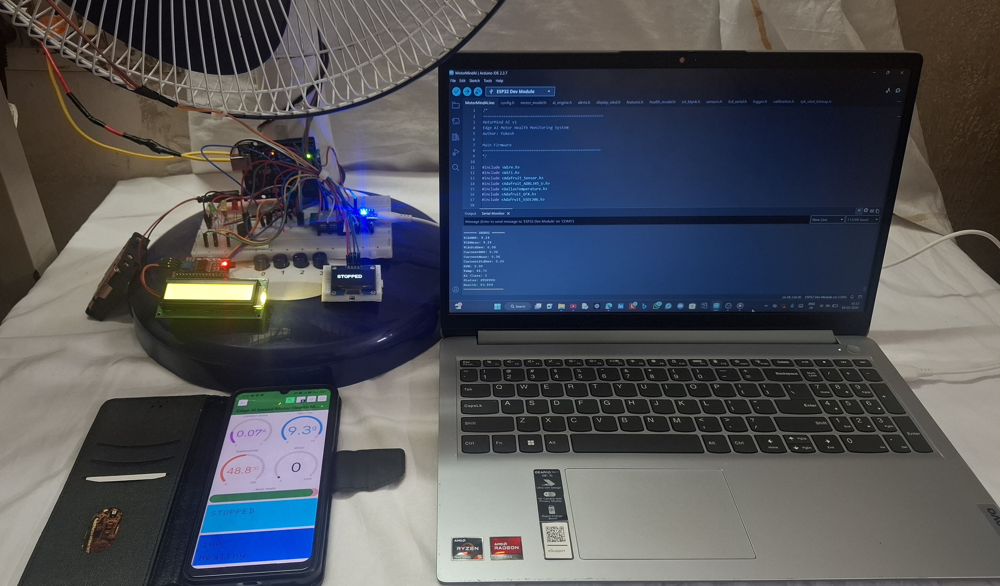 | 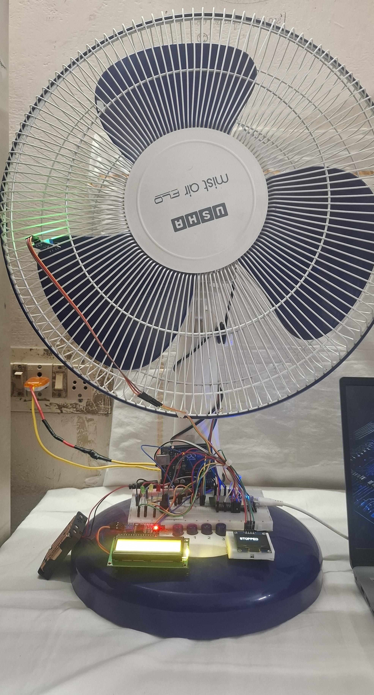 |

| Hardware Breadboard & Displays |
| :---: |
| 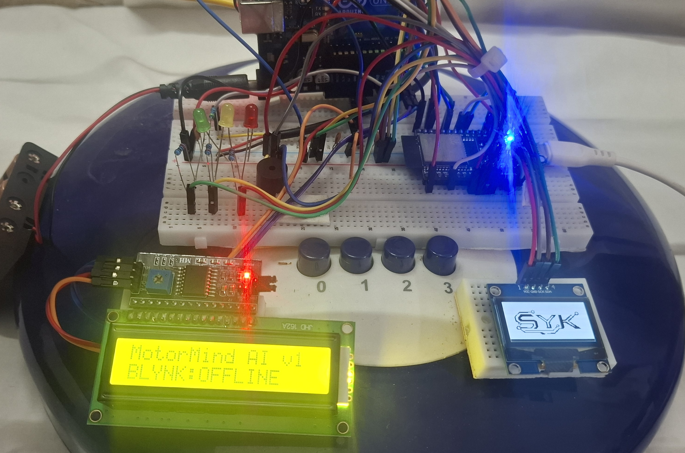 |

### 10.4 Sensor Mounting Details
| ADXL345 Vibration Sensor | DS18B20 Temperature Sensor | ACS712 Current Sensor |
| :---: | :---: | :---: |
| 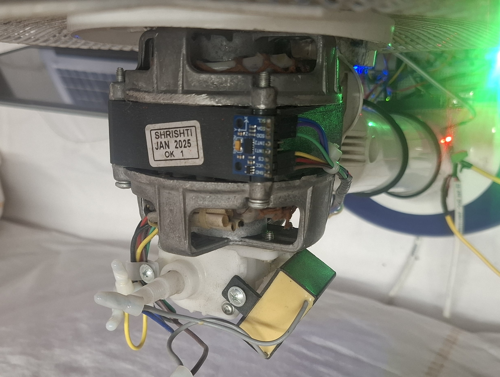 | 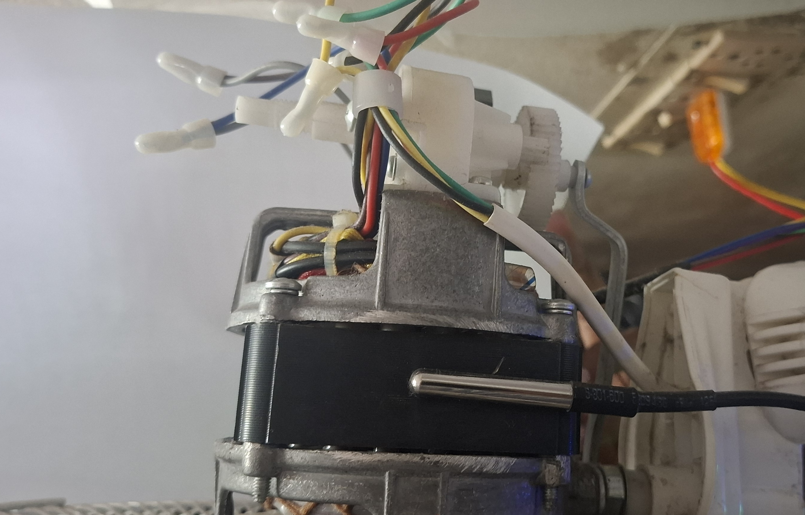 | 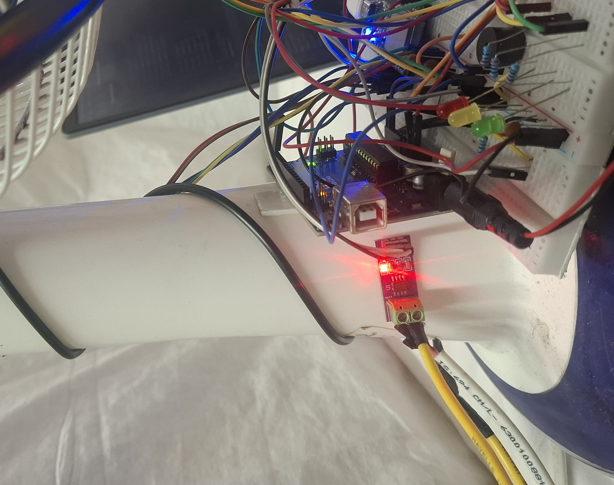 |

### 10.5 IoT Remote Telemetry Dashboard
The dashboard displays continuous streams of temperature, current draw, and vibration profiles alongside live alerts.

<p align="center">
  
  
</p>

---

## 11. Author & Licensing
*   **Author:** Aishik Tokdar
*   **License:** Distributed under the MIT License. See `LICENSE` for details.
