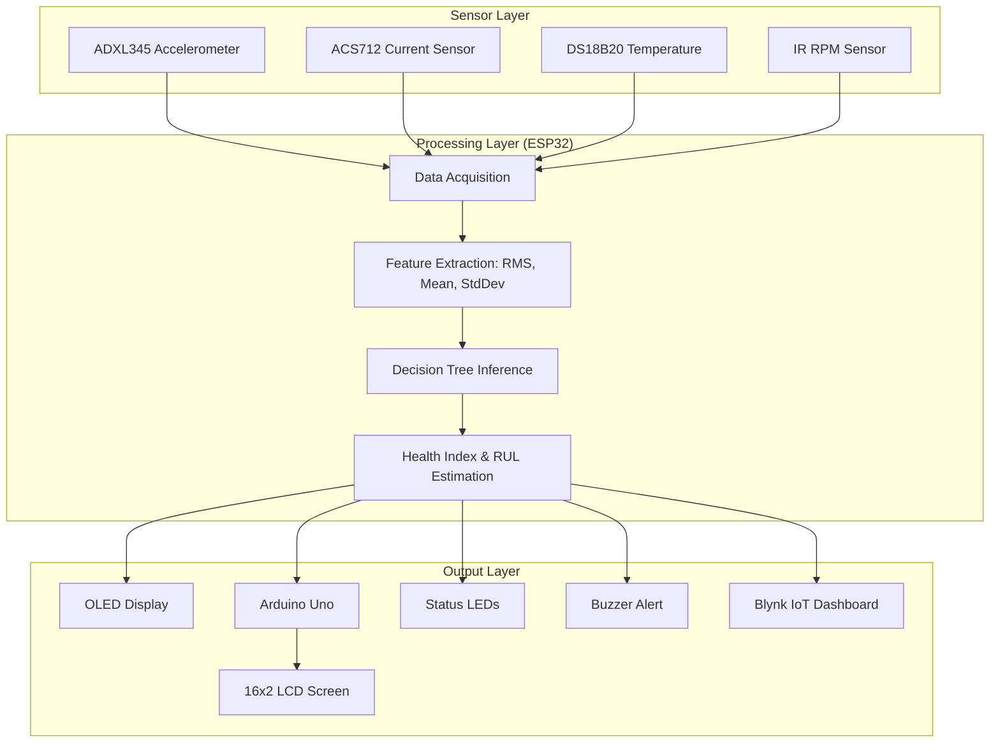

# Real-Time Motor Health Monitoring and Predictive Fault Detection

An embedded Edge AI system designed for real-time monitoring, multi-sensor data fusion, and predictive fault diagnostics of electric motors using the ESP32 microcontroller. 

For a comprehensive study of the system's design, mathematical modeling, and experimental results, please refer to the full [Project Report](Docs/Project_Report.pdf).

---

## 1. Overview
This project presents an end-to-end edge-computing pipeline for monitoring electric motor health and predicting failures. By performing feature extraction and machine learning model inference locally on the ESP32, the system achieves low latency, high reliability, and operational independence from cloud network connectivity.

Conventional threshold-based monitoring systems can only flag failures after they occur. This project overcomes that limitation by using on-device machine learning (a Decision Tree classifier) to detect early indicators of mechanical imbalance, overheating, and overcurrent conditions, alongside estimating the motor's **Remaining Useful Life (RUL)**.

---

## 2. Key Features
*   **Real-Time Multi-Sensor Fusion:** Simultaneous acquisition of vibration, current, temperature, and rotational speed (RPM).
*   **On-Device Feature Extraction:** Statistical signal processing (RMS, mean, standard deviation) computed directly on the ESP32.
*   **Edge Machine Learning:** Local inference via an optimized Decision Tree classifier (zero cloud latency or dependency).
*   **Predictive Diagnostics:** Custom algorithms to compute a Motor Health Index and estimate the Remaining Useful Life (RUL).
*   **Multi-Tier Output System:**
    *   *Local UI:* SSD1306 OLED display for immediate parameter reading.
    *   *System Status Display:* Dedicated 16x2 LCD module controlled via an Arduino Uno.
    *   *Visual/Audible Alerts:* Status LEDs (Normal, Warning, Fault) and an active buzzer.
*   **IoT Integration:** Real-time remote telemetry and status dashboard using Blynk.

---

## 3. System Architecture

The architecture consists of three core operational layers:



### 3.1 Data Flow and Signal Processing
1.  **Sensor Layer:** Collects 3-axis vibration (ADXL345), analog current (ACS712), ambient motor temperature (DS18B20), and pulse-based RPM readings.
2.  **Processing Layer:** 
    *   Computes Mean, RMS, and Standard Deviation for vibration and current over a window of samples.
    *   Runs the localized machine learning classifier.
    *   Mitigates false positives using a multi-cycle status confirmation filter.
3.  **Output Layer:** Distributes telemetry to local outputs (OLED, LEDs, Buzzer), transmits serial status packets to the secondary Arduino-driven LCD display, and syncs data to the Blynk cloud via Wi-Fi.

### 3.2 System Flowchart


---

## 4. Hardware Configuration & Wiring

### 4.1 Bill of Materials (BOM)
Detailed component specifications are available in the project's [BOM Spreadsheet](BOM_v1.xlsx). A quick summary of key parts:

| S.No | Component | Quantity | Primary Function |
| :--- | :--- | :--- | :--- |
| 1 | ESP32 Microcontroller | 1 | System hub, feature extraction, and ML inference |
| 2 | ADXL345 Accelerometer | 1 | 3-axis acceleration/vibration monitoring |
| 3 | ACS712 Current Sensor (20A) | 1 | Current draw measurement |
| 4 | DS18B20 Temperature Sensor | 1 | Thermal analysis |
| 5 | IR Speed Sensor | 1 | Rotational speed (RPM) calculation |
| 6 | SSD1306 OLED (128x64) | 1 | Live parameter display |
| 7 | Arduino Uno | 1 | Handles secondary UART-to-LCD display pipeline |
| 8 | LCD Module (16x2 I2C) | 1 | Continuous status text output |
| 9 | Buzzer & Status LEDs | 4 | Real-time audio-visual alerts |

### 4.2 Pin Mappings

#### ESP32 Microcontroller
| Connected Device | ESP32 Pin | Interface Type | Purpose |
| :--- | :--- | :--- | :--- |
| **IR Sensor** | GPIO27 | Digital Input | RPM measurement |
| **ACS712 Sensor** | GPIO34 | Analog Input | Current monitoring |
| **DS18B20 Sensor** | GPIO4 | One-Wire | Temperature monitoring |
| **SSD1306 OLED** | GPIO21 (SDA) / GPIO22 (SCL) | I2C | Local data visualization |
| **ADXL345 Sensor** | GPIO21 (SDA) / GPIO22 (SCL) | I2C (Shared) | Vibration data acquisition |
| **Buzzer** | GPIO26 | Digital Output | Alarm trigger |
| **Normal LED** | GPIO18 | Digital Output | Indicates healthy operation |
| **Warning LED** | GPIO19 | Digital Output | Indicates moderate anomalies |
| **Fault LED** | GPIO33 | Digital Output | Indicates critical failure state |
| **Arduino Uno** | GPIO25 (TX) | UART Serial | Status transmission |

#### Arduino Uno (LCD Subsystem)
| Connected Device | Arduino Pin | Interface Type | Purpose |
| :--- | :--- | :--- | :--- |
| **ESP32 TX** | Pin 2 (RX) | SoftwareSerial | Receives status packets |
| **LCD SDA / SCL** | Pin A4 / Pin A5 | I2C | Screen control output |

> [!IMPORTANT]
> A common Ground (GND) wire must connect the ESP32 and the Arduino Uno. Without a shared ground reference, serial UART communications will fail or generate corrupted data packets.

---

## 5. Repository Directory Structure
```
Real-Time-Motor-Health-Monitoring-and-Predictive-Fault-Detection/
│
├── Docs/                              # Technical diagrams and project files
│   ├── block_diagram.png              # System structural layout
│   ├── flow_chart.png                 # Processing logic flowchart
│   └── Project_Report.pdf             # Comprehensive technical paper
│
├── Firmware/                          # Main modular ESP32 firmware (v2)
│   ├── Firmware.ino                   # Main execution loop and setup
│   ├── config.h                       # Hardcoded pin mappings & thresholds
│   ├── sensors.h                      # Sensor drivers & sampling logic
│   ├── features.h                     # RMS & Mean computation utilities
│   ├── ai_engine.h                    # Model execution framework
│   ├── health_model.h                 # Health index & RUL logic
│   ├── display_oled.h                 # SSD1306 screen controller
│   ├── iot_blynk.h                    # Cloud Wi-Fi & Blynk sync
│   ├── lcd_serial.h                   # UART communication to Arduino
│   ├── logger.h                       # Debug logging via Serial
│   ├── alerts.h                       # Alert logic for buzzer & LEDs
│   ├── calibration.h                  # Sensor calibration utilities
│   ├── motor_model.h                  # Machine learning classifier header
│   └── syk_oled_bitmap.h              # Bitmap assets for OLED
│
├── Firmware_old/                       # Legacy single-file firmware
│   ├── Firmware_old.ino                # Monolithic ESP32 code structure
│   └── motor_model.h                  # Machine learning classifier header
│
├── LCD_Display/                       # Subsystem driving the 16x2 LCD
│   └── Arduino_LCD_Animation.ino      # Arduino Uno status display code
│
├── Machine_Learning/                  # Python workspace for model training
│   ├── dataset.txt                    # Raw sensor telemetry logs
│   ├── train_motor_model.py           # Random Forest training script
│   ├── train_tinyml_model.py          # Decision Tree training script
│   ├── convert_to_c.py                # TinyML C header exporter
│   ├── motor_fault_model.pkl          # Serialized Random Forest model
│   ├── tinyml_model.pkl               # Serialized Decision Tree model
│   └── motor_model.h                  # Exported C class representing DT
│
├── Images/                            # Physical wiring & setup photo gallery
│   ├── acs712_current_sensor_setup.jpg
│   ├── adxl345_vibration_sensor_setup.jpg
│   ├── ds18b20_temp_sensor_setup.jpg
│   ├── full_system_setup.jpg
│   ├── hardware_breadboard_setup.jpg
│   └── motor_fan_system_setup.jpg
│
├── hardware/                          # Microcontroller circuit diagrams
│   ├── Arduino_Circuit/
│   │   └── arduino_lcd_circuit_diagram.jpeg
│   └── ESP32_Circuit/
│       └── esp32_breadboard_circuit_diagram.png
│
├── BOM_v1.xlsx                        # Bill of Materials Spreadsheet
├── circuit_diagram.png                # Overall electrical connection schematic
├── LICENSE                            # MIT License
└── README.md                          # Repository documentation
```

---

## 6. Machine Learning Pipeline
The predictive fault detection engine is trained using a supervised classifier to run directly on the resource-constrained ESP32.

```
   [Raw Sensor Telemetry] (dataset.txt)
             │
             ▼
   [Feature Engineering] (Extract Vibration & Current Mean, RMS, StdDev)
             │
             ▼
   [Model Training] (Decision Tree Classifier, max_depth=6)
             │
             ▼
   [micromlgen Conversion] (convert_to_c.py)
             │
             ▼
   [Embedded Header] (motor_model.h) ──> Imported into [ESP32 Firmware]
```

### 6.1 Input Features
*   `x[0]`: Vibration RMS
*   `x[1]`: Vibration Mean
*   `x[2]`: Vibration Standard Deviation (Vibration StdDev)
*   `x[3]`: Current RMS
*   `x[4]`: Current Mean
*   `x[5]`: Current Standard Deviation (Current StdDev)
*   `x[6]`: Rotational Speed (RPM)
*   `x[7]`: Temperature (°C)

### 6.2 Target Fault Classes
The model categorizes the motor's operational status into five states:
1.  **Normal:** Baseline operation.
2.  **Warning:** Moderate deviations signaling inspection is required.
3.  **Overcurrent Fault:** High electrical draw risking winding damage.
4.  **Overheating Fault:** Excessive operating temperatures.
5.  **Imbalance Fault:** High mechanical vibration/misalignment.

---

## 7. Mathematical Modeling for Health & RUL

### 7.1 Motor Health Index
The system dynamically computes a Motor Health Index ($H$) on a scale from 0 to 100%. It measures weighted deviations from healthy baseline values:

$$H = 100 - (w_v \cdot \Delta V + w_i \cdot \Delta I + w_t \cdot \Delta T)$$

Where:
*   $\Delta V, \Delta I, \Delta T$ are the normalized absolute deviations of vibration, current, and temperature from calibrated baselines.
*   $w_v, w_i, w_t$ are weight coefficients adjusting the sensitivity of each component.

### 7.2 Remaining Useful Life (RUL)
The Remaining Useful Life (in hours or percentage) is calculated using a health degradation rate:

$$\text{RUL} = f(H) = \text{clamp}\left(1.25 \cdot (H - 20), 0, 100\right)$$

*   **RUL > 80%:** Healthy operation; standard routine check.
*   **30% < RUL <= 80%:** Moderate degradation; scheduled maintenance advised.
*   **RUL <= 30%:** Severe degradation / Active failure; immediate shutdown and service required.

---

## 8. Setup & Deployment Guide

Follow this sequential, phase-by-phase guide to assemble the hardware, configure the development tools, initialize the cloud telemetry platform, and deploy the code.

---

### Phase 1: Hardware Assembly & Connections
1. **Circuit Assembly:** Connect the sensors, displays, and output modules to the microcontrollers according to the [Circuit Diagram](circuit_diagram.png), [ESP32 Wiring Diagram](hardware/ESP32_Circuit/esp32_breadboard_circuit_diagram.png), [Arduino Wiring Diagram](hardware/Arduino_Circuit/arduino_lcd_circuit_diagram.jpeg), and pinout tables in **Section 4.2**.
2. **Serial Interface Link:** Wire the UART serial communication bridge:
   * Connect ESP32 `GPIO25` (TX) directly to Arduino Uno `Pin 2` (RX).
   * **Crucial Ground Connection:** Run a jumper wire connecting a `GND` pin on the ESP32 to a `GND` pin on the Arduino Uno.
3. **Power Checks:** Ensure the system receives stable power. It is recommended to power the ESP32 and Arduino Uno from separate USB rails during testing, or use a filtered 5V DC step-down power supply module.

---

### Phase 2: Arduino IDE & Environment Configuration
1. **Download IDE:** Install the latest version of the [Arduino IDE](https://www.arduino.cc/en/software).
2. **Add ESP32 Board support:**
   * Open Arduino IDE and navigate to **File** → **Preferences**.
   * Locate the **Additional Boards Manager URLs** text box and paste the following URL:
     ```
     https://raw.githubusercontent.com/espressif/arduino-esp32/gh-pages/package_esp32_index.json
     ```
   * Click **OK**. Go to **Tools** → **Board** → **Boards Manager**, search for `esp32` by *Espressif Systems*, and click **Install**.
3. **Install Required Libraries:**
   * Go to **Tools** → **Manage Libraries...** to open the Library Manager.
   * Search for and install the latest versions of the following libraries:
     * **Adafruit ADXL345** (by Adafruit) — Accelerometer sensor driver.
     * **Adafruit Unified Sensor** (by Adafruit) — Base sensor abstraction framework.
     * **DallasTemperature** (by Miles Burton) — Digital temperature probe library.
     * **OneWire** (by Paul Stoffregen) — Protocol bus interface.
     * **Adafruit SSD1306** (by Adafruit) — OLED screen driver.
     * **Adafruit GFX Library** (by Adafruit) — Graphics rendering engine.
     * **Blynk** (by Volodymyr Shymanskyy) — IoT platform client library.
     * **hd44780** (by Bill Perry) — Highly optimized I2C LCD screen controller.

---

### Phase 3: Blynk IoT Cloud Setup
To enable remote telemetry monitoring, configure a Blynk 2.0 template and device profile:
1. **Create Account:** Log in to the [Blynk IoT Web Console](https://blynk.cloud/).
2. **Create a Template:**
   * Click **Templates** in the left sidebar, select **+ New Template**, and input:
     * *Name:* `Motor Health Monitoring`
     * *Hardware:* `ESP32`
     * *Connection:* `WiFi`
   * Click **Done**.
3. **Define Datastreams (Virtual Pins):**
   * Go to the **Datastreams** tab, click **+ New Datastream** → **Virtual Pin**, and add the following 12 datastreams:
     * **V0 (Temperature):** Double/Float, Unit: `°C`, Range: `0` to `100`.
     * **V1 (Vibration):** Double/Float, Unit: `m/s²`, Range: `0` to `10`.
     * **V2 (Current):** Double/Float, Unit: `A`, Range: `0` to `20`.
     * **V3 (Motor Health):** Integer, Unit: `%`, Range: `0` to `100`.
     * **V4 (Fault Status):** String/Text.
     * **V5 (RPM):** Integer, Unit: `rpm`, Range: `0` to `4000`.
     * **V6 (Normal LED):** Integer, Range: `0` to `1`.
     * **V7 (Warning LED):** Integer, Range: `0` to `1`.
     * **V8 (Fault LED):** Integer, Range: `0` to `1`.
     * **V9 (Buzzer State):** Integer, Range: `0` to `1`.
     * **V10 (Remaining Useful Life):** Integer, Unit: `%`, Range: `0` to `120`.
     * **V11 (Maintenance Message):** String/Text.
4. **Build Dashboard Layout:**
   * Go to the **Web Dashboard** tab.
   * Drag onto the canvas and bind the widgets to their corresponding datastreams:
     * **Gauges:** Motor Health (`V3`), Temperature (`V0`), RPM (`V5`).
     * **Charts (Super Chart):** Vibration (`V1`), Current (`V2`).
     * **Value Boxes:** Fault Status (`V4`), RUL (`V10`), Maintenance Advice (`V11`).
     * **LED widgets:** Normal LED (`V6`), Warning LED (`V7`), Fault LED (`V8`).
   * Click **Save** on the template editor.
5. **Create Device & Copy Tokens:**
   * Go to the **Search** (Device list) tab, click **+ New Device** → **From Template**, and select `Motor Health Monitoring`.
   * Under the device screen, copy the configuration block code containing `BLYNK_TEMPLATE_ID`, `BLYNK_TEMPLATE_NAME`, and `BLYNK_AUTH_TOKEN`.
6. **Set Event Alerts:**
   * Return to the `Motor Health Monitoring` Template edit screen.
   * Under the **Events** tab, click **+ Add Event**.
   * Add a critical alert with Code: `motor_fault`, Name: `motor_fault`, Level: `Critical`, Description: `Motor health critical! Maintenance required.`.
   * Enable push notifications/emails in the event's **Notifications** tab, and save.

---

### Phase 4: Local Code Customization
1. Open the project firmware files in your Arduino IDE:
   * **Recommended version:** Open `Firmware/Firmware.ino`.
   * **Monolithic/Legacy version:** Open `Firmware_old/Firmware_old.ino`.
2. Locate the credentials configuration block (in `config.h` for modular, or at the top of the sketch for monolithic) and enter your Wi-Fi credentials and Blynk device tokens:
   ```cpp
   #define WIFI_SSID "YOUR_WIFI_SSID"
   #define WIFI_PASS "YOUR_WIFI_PASSWORD"
   
   #define BLYNK_TEMPLATE_ID "YOUR_TEMPLATE_ID"
   #define BLYNK_TEMPLATE_NAME "YOUR_TEMPLATE_NAME"
   #define BLYNK_AUTH_TOKEN "YOUR_BLYNK_AUTH_TOKEN"
   ```

---

### Phase 5: Software Compilation and Upload Sequence
To avoid port conflicts, deploy the firmware to the target boards in this sequence:

1. **Deploy LCD Subsystem to Arduino Uno:**
   * Connect your Arduino Uno board to your PC via a USB cable.
   * Open `LCD_Display/Arduino_LCD_Animation.ino` in the Arduino IDE.
   * Go to **Tools** → **Board** and select **Arduino Uno**. Choose the correct COM port.
   * Click **Upload** (arrow icon). Once compilation and upload are complete, disconnect the Arduino.
2. **Deploy Core Firmware to ESP32:**
   * Connect your ESP32 board to your PC.
   * Open `Firmware/Firmware.ino` (or `Firmware_old/Firmware_old.ino`).
   * Go to **Tools** → **Board** and select your ESP32 board (e.g., `ESP32 Dev Module`). Select the matching COM port.
   * Click **Upload**. 
   * *Troubleshooting Note:* If the console displays connection retry prints (`Connecting....___`), press and hold the physical **BOOT** button on the ESP32 board until the flash write process starts, then release it.

---

### Phase 6: Machine Learning Workspace & Dataset Setup
To train or re-train the embedded Decision Tree classifier, you must configure the dataset and execute the Python workspace pipeline.

#### Step 1: Configure the Telemetry Dataset (`dataset.txt`)
Choose one of the following methods to prepare your dataset:
*   **Method A: Use the Pre-packaged Dataset (Default)**
    *   The repository comes pre-loaded with a labeled telemetry dataset at `Machine_Learning/dataset.txt`. It contains 900+ samples of motor operations across multiple states (Stopped, Normal, Overcurrent, Overheat, Unbalance).
*   **Method B: Collect a Custom Telemetry Dataset**
    *   Assemble the physical system and connect the ESP32 to your PC.
    *   Open the Arduino IDE **Serial Monitor** at **115200** baud and send the character `c` to put the logger into **DATASET** mode.
    *   Run the motor under different conditions (e.g., normal load, mechanical imbalance, thermal stress) and copy the printed CSV telemetry lines.
    *   Create or append these lines to `Machine_Learning/dataset.txt`. Ensure the file starts with the following header:
        ```csv
        time_ms,vib_rms,vib_mean,vib_std,current_rms,current_mean,current_std,rpm,temp_C,status
        ```
*   **Method C: Download/Import an External Dataset**
    *   If you have downloaded a telemetry log from an external motor testing rig, save it as a comma-separated values (CSV) file, rename it to `dataset.txt`, and place it in the `Machine_Learning/` directory, confirming that the column headers match the 10 fields above.

#### Step 2: Install Dependencies & Train the Model
1. Navigate to the `Machine_Learning/` directory.
2. Install Python dependency packages:
   ```bash
   pip install pandas scikit-learn joblib micromlgen
   ```
3. Execute the training script to evaluate features and generate the binary pickle model:
   ```bash
   python train_tinyml_model.py
   ```
4. Export the trained Decision Tree classifier logic into an optimized C++ header file:
   ```bash
   python convert_to_c.py
   ```
5. Copy the newly generated `motor_model.h` file from `Machine_Learning/` into the `Firmware/` and `Firmware_old/` directories, replacing the existing files.

---

## 9. System Verification & Testing Procedures

Follow these structured tests to verify that the hardware, machine learning model, and IoT dashboards are executing correctly.

### 9.1 Offline Serial Telemetry Testing
1. Connect the ESP32 to your PC and open the Arduino IDE **Serial Monitor**. Set the baud rate to **115200**.
2. Press the **EN/RST** button on the ESP32. You should see startup log prints and calibration messages.
3. Send the following character commands (single letters) via the Serial input bar to change telemetry modes:

*   **Send `d` (DEBUG mode):** Logs raw statistical feature vectors. Verify that current, temperature, RPM, and vibration StdDev values are printing continuously.
*   **Send `i` (INFO mode):** Prints a streamlined view showing `RPM | Temp | Health % | Status`. Useful for checking baseline statistics.
*   **Send `c` (DATASET mode):** Prints formatted comma-separated values (CSV) matching the format of `dataset.txt`. Use this stream to collect custom logs to re-train your ML model.

### 9.2 Sensor Diagnostic Verification
With the Serial Monitor set to `d` (DEBUG) mode, verify each sensor responds to stimulation:
*   **Vibration Test:** Tap or shake the ADXL345 accelerometer. Vibration RMS (`VibRMS`) and Standard Deviation (`VibStdDev`) should spike, and `Health` should decrease.
*   **Temperature Test:** Place a finger on the metallic probe of the DS18B20. The `Temp` reading should rise from room temperature (~25°C) to near body temperature (~32°C–36°C).
*   **RPM Test:** Spin the motor shaft (or block the IR sensor slot repeatedly). The `RPM` value should register the rotational speed. If it remains `0`, check your optical alignment.
*   **Current Test:** Turn on the motor. The current RMS (`CurrentRMS`) should rise from `0.0A` to the motor's operating current draw.

### 9.3 AI Model & Fault Logic Simulation
To verify the Decision Tree classifier is functioning:
1.  **Stopped State:** Ensure the motor is turned OFF.
    *   Verify the OLED display reads `STOPPED`.
    *   Verify the 16x2 LCD display reads `STATUS:STOPPED`.
    *   Ensure all status LEDs are OFF.
2.  **Fault Filtering Check:** Simulate a mechanical shake on the accelerometer.
    *   The model should predict an `IMBALANCE` class.
    *   Observe the Serial Monitor. The `abnormalCount` should increase from `1` to `2`.
    *   If you stop shaking before the count reaches `3`, the status must remain `NORMAL`.
    *   If you continue the shake for more than 3 consecutive measurement cycles, the alarm must trigger, changing `STATUS` to `UNBALANCE`, activating the red LED, and sounding the buzzer.

### 9.4 Blynk Cloud Synchronization Check
1.  Open the Blynk Web Console or Mobile App.
2.  Check the status icon. The device should show **Online**.
3.  Turn on the motor and verify that the virtual pin gauges and graphs update dynamically every 2 seconds.
4.  **Notification Event Test:** Temporarily lower the `HEALTH_CRITICAL_LEVEL` or trigger a fault state.
    *   Ensure the device health falls below `30%`.
    *   Check your mobile notifications/email. You should receive a critical push notification: *"Motor health critical! Maintenance required."*

### 9.5 LCD Display Communication Check
1.  Verify the 16x2 LCD display receives data from the ESP32.
2.  During bootup, verify it cycles through `WIFI:CONNECTING`, `WIFI:CONNECTED`, `Blynk:OFFLINE`, and `Blynk:ONLINE`.
3.  During operation, verify it updates status messages (e.g., `STATUS:NORMAL`, `STATUS:STOPPED`, `FAULT:OVERHEAT`) in sync with the local OLED display.

---

## 10. Project Media

### 10.1 Hardware Setup & Prototype


*Detailed prototype assembly:*


### 10.2 IoT Remote Telemetry Dashboard
The dashboard displays continuous streams of temperature, current draw, and vibration profiles alongside live alerts.

<p align="center">
  
  
</p>

---

## 11. Author & Licensing
*   **Author:** Aishik Tokdar
*   **License:** Distributed under the MIT License. See `LICENSE` for details.
